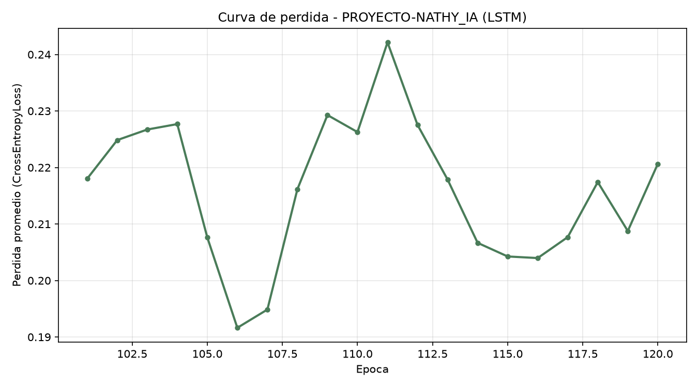

# Curva de pérdida del entrenamiento — PROYECTO-NATHY_IA

Esta carpeta contiene la visualización de cómo se comportó la pérdida (loss) durante el entrenamiento de la LSTM.

## ¿Qué es la "pérdida" (loss)?

Es un número que mide qué tan lejos están las predicciones del modelo de la respuesta correcta. Entre más bajo, mejor está prediciendo la siguiente palabra. Se calcula con `CrossEntropyLoss` (ya usada en el curso) y se va recalculando en cada época de entrenamiento.

## Cómo se generó

1. Se le agregó a `src/entrenamiento.py` un registro automático: cada época que se entrena, guarda su número y su pérdida promedio en `data/processed/historial_perdida.csv`.
2. Se corrió una tanda de 20 épocas nuevas (`python src/entrenamiento.py 20`) sobre el modelo ya entrenado (que venía de 100 épocas), llegando a 120 épocas totales — esto generó los primeros datos reales del historial (las primeras 100 épocas no quedaron registradas porque el registro se agregó después).
3. Se corrió `notebooks/graficar_perdida.py`, que lee ese CSV y dibuja la curva con matplotlib.

## Resultado

<p align="center">
  
</p>

## Lectura del resultado

La pérdida se mueve entre ~0.19 y ~0.24 sin una tendencia clara hacia abajo entre la época 101 y la 120 — es decir, el modelo ya **convergió**: llegó al límite de lo que puede aprender con esta arquitectura y esta cantidad de datos (60 canciones). Entrenar más épocas a partir de aquí ya no mejora mucho más el resultado; para seguir bajando la pérdida de forma significativa haría falta más datos de entrenamiento o ajustar la arquitectura (por ejemplo, más neuronas en la capa oculta o más capas LSTM).

## Cómo volver a generarla

```bash
python notebooks/graficar_perdida.py
```

(Requiere que `data/processed/historial_perdida.csv` ya exista, generado al entrenar con `src/entrenamiento.py`).

---
[⬅ Volver al README principal](../README.md)
